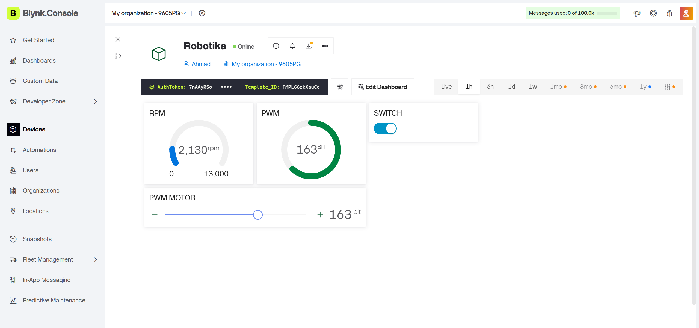
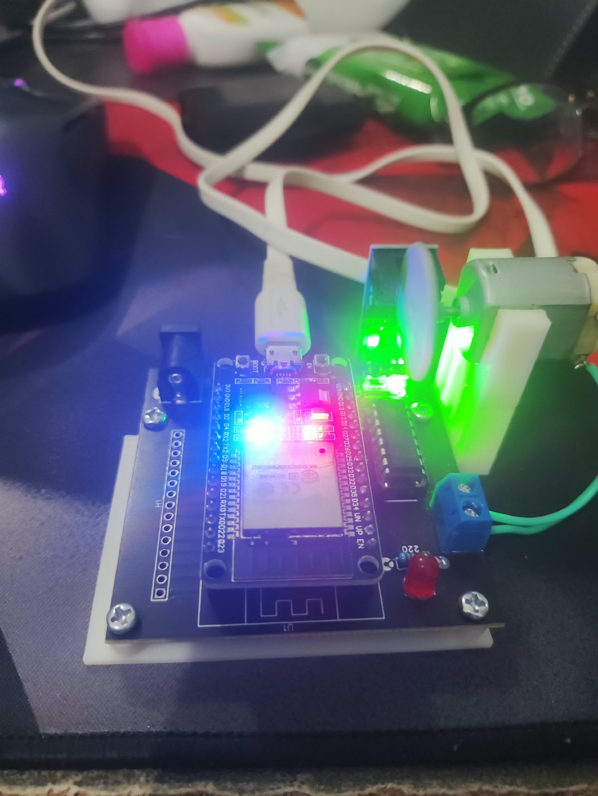

# LAPORAN PRAKTIKUM ROBOTIKA

## Modul 3: Monitoring RPM dan Pengendalian PWM Motor DC Menggunakan Blynk IoT pada ESP32

# BAB 1: PENDAHULUAN DAN SPESIFIKASI SISTEM

## 1.1 Latar Belakang

Praktikum ini membahas pengendalian motor DC dan pemantauan kecepatan putaran menggunakan Kit Robotika iMCLab berbasis ESP32 yang terintegrasi dengan Blynk IoT. Sistem memungkinkan pengguna mengatur nilai PWM motor melalui dashboard Blynk serta memantau kecepatan putaran motor dalam satuan *Revolutions Per Minute* (RPM). ESP32 menerima perintah dari Blynk melalui jaringan Wi-Fi, membaca pulsa sensor encoder, dan mengirimkan data hasil pengukuran ke dashboard secara berkala. Praktikum ini bertujuan memahami penerapan komunikasi IoT dalam sistem kendali dan monitoring robotika.

## 1.2 Spesifikasi Sistem

| Komponen | Konfigurasi |
|---|---|
| Mikrokontroler | ESP32 |
| Platform IoT | Blynk IoT |
| Pemrograman | Arduino IDE (C++) |
| Komunikasi jaringan | Wi-Fi |
| Baud rate Serial Monitor | 115200 |
| Frekuensi PWM | 30.000 Hz |
| Resolusi PWM | 8 bit |
| Rentang duty cycle | 0–255 |

# BAB 2: DASAR TEORI

## 2.1 Blynk IoT dan Komunikasi Wi-Fi

Blynk IoT merupakan platform yang digunakan sebagai antarmuka monitoring dan pengendalian perangkat melalui jaringan. Pada praktikum ini, ESP32 terhubung ke Blynk melalui Wi-Fi. Pengguna dapat mengatur PWM menggunakan slider dan mengendalikan motor melalui tombol pada dashboard. Data RPM dan PWM dikirimkan dari ESP32 ke Blynk menggunakan virtual pin.

## 2.2 Pulse Width Modulation (PWM)

PWM digunakan untuk mengatur keluaran daya pada driver motor DC melalui perubahan *duty cycle*. Program menggunakan resolusi 8 bit sehingga nilai PWM berada pada rentang 0–255. Nilai tersebut menentukan besarnya duty cycle, tetapi kecepatan aktual motor juga dipengaruhi oleh beban, catu daya, dan karakteristik motor.

## 2.3 Sensor Encoder dan Perhitungan RPM

Sensor encoder menghasilkan pulsa ketika poros motor berputar. ESP32 menghitung pulsa melalui interrupt, kemudian memperkirakan kecepatan putaran dalam RPM berdasarkan jumlah pulsa per putaran dan interval pengukuran. Program menerapkan penyaringan pulsa berdekatan menggunakan *debounce* untuk membantu mengurangi pembacaan pulsa yang tidak diinginkan.

# BAB 3: IMPLEMENTASI PROGRAM DAN HASIL PENGUJIAN

## 3.1 Tujuan Pengujian

1. Mengintegrasikan ESP32 dengan platform Blynk IoT melalui Wi-Fi.
2. Menguji pengendalian motor DC menggunakan slider PWM dan tombol ON/OFF.
3. Mengukur kecepatan putaran motor berdasarkan pulsa sensor encoder.
4. Mengirimkan data RPM dan PWM ke dashboard Blynk secara berkala.
5. Menganalisis hubungan antara perintah kendali, nilai PWM, dan hasil monitoring RPM.

## 3.2 Kode Program

Program menggunakan library `WiFi.h`, `WiFiClient.h`, dan `BlynkSimpleEsp32.h` untuk menghubungkan ESP32 ke jaringan dan platform Blynk. Bagian kode berikut merupakan cuplikan awal program. Lanjutkan bagian kode lainnya dari sumber program lengkap.

> **Keamanan:** Gunakan placeholder untuk token Blynk dan kredensial Wi-Fi apabila laporan dipublikasikan di repository GitHub publik.

```cpp
/**************************************************
******* 
- iMCLab + ESP32 + Blynk IoT 
- RPM Monitoring dan Kontrol PWM 
***************************************************
******/ 

#define BLYNK_TEMPLATE_ID "TMPL66zkXauCd"
#define BLYNK_TEMPLATE_NAME "Robotika"
#define BLYNK_AUTH_TOKEN "*****" 

#include <WiFi.h>
#include <WiFiClient.h>
#include <BlynkSimpleEsp32.h>
 
// Konfigurasi Wifi 
char auth[] = BLYNK_AUTH_TOKEN; 
char ssid[] = "*****"; 
char pass[] = "*****"; 
 
// ============================================================
// Motor dan LED 
// ============================================================ 
int ledPin = 2; 
 
int motor1Pin1 = 27; 
int motor1Pin2 = 26; 
int enable1Pin = 12; 
 
// ============================================================
// Sensor RPM 
// ============================================================ 
const byte pin_rpm = 13; 
const int HOLES = 2; 
 
volatile unsigned int rev = 0; 
volatile unsigned long lastPulseTime = 0; 
const unsigned long DEBOUNCE_US = 500; 
 
// ============================================================
// PWM 
// ============================================================ 
const int freq = 30000; 
const int pwmChannel = 0; 
const int resolution = 8; 
int dutyCycle = 200; 
const int DUTY_STEP = 10; 
const int DUTY_MIN = 0; 
const int DUTY_MAX = 255; 
bool motorEnable = false; 

// ============================================================
// RPM 
// ============================================================ 
float rpm = 0.0; 
unsigned long old_time = 0; 

// ============================================================
String inputString = ""; 
BlynkTimer timer; 

// ============================================================
// ISR Encoder 
// ============================================================ 
void IRAM_ATTR isr() 
{ 
  unsigned long now = micros(); 
  if (now - lastPulseTime > DEBOUNCE_US) 
  { 
    rev++; 
    lastPulseTime = now; 
  } 
} 
 
// ============================================================
// Sync setelah reconnect Blynk 
// ============================================================ 
BLYNK_CONNECTED() 
{ 
  Blynk.syncVirtual(V2); 
  Blynk.syncVirtual(V3); 
} 
 
// ============================================================
// Hitung RPM 
// ============================================================ 
void hitungRPM() 
{ 
  unsigned long cur_time = millis(); 
 
  if (cur_time - old_time >= 1000) 
  { 
    detachInterrupt(digitalPinToInterrupt(pin_rpm)); 
 
    float rot_per_sec = (float)rev / (float)HOLES; 
    rpm = rot_per_sec * 60.0; 
    rev = 0; 
 
    attachInterrupt(digitalPinToInterrupt(pin_rpm), isr, FALLING); 
    old_time = millis(); 
  } 
} 
 
// ============================================================
// Terapkan PWM ke Motor 
// ============================================================ 
void applyMotor() 
{ 
  digitalWrite(motor1Pin1, HIGH); 
  digitalWrite(motor1Pin2, LOW); 
  ledcWrite(pwmChannel, dutyCycle); 
  digitalWrite(ledPin, dutyCycle > 0); 
} 

// ============================================================
// Status Serial 
// ============================================================ 
void tampilkanStatus(const char* aksi) 
{ 
  Serial.print(aksi); 
  Serial.print(" | PWM="); 
  Serial.print(dutyCycle); 
  Serial.print(" | RPM="); 
  Serial.println(rpm, 1); 
} 

// ============================================================
// Kirim Data ke Blynk 
// ============================================================ 
void kirimKeBlynk() 
{ 
  Blynk.virtualWrite(V0, rpm); 
  Blynk.virtualWrite(V1, dutyCycle); 
  Blynk.virtualWrite(V2, dutyCycle); 
  Blynk.virtualWrite(V3, dutyCycle > 0); 
} 

// ============================================================
// Slider PWM dari Blynk (V2) 
// ============================================================ 
BLYNK_WRITE(V2) 
{ 
  dutyCycle = constrain(param.asInt(), DUTY_MIN, DUTY_MAX); 
  motorEnable = (dutyCycle > 0); 
  applyMotor(); 
  Serial.print("PWM dari Blynk = "); 
  Serial.println(dutyCycle); 
} 
 
// ============================================================
// Tombol ON/OFF dari Blynk (V3) 
// ============================================================ 
BLYNK_WRITE(V3) 
{ 
  motorEnable = param.asInt(); 
 
  if (motorEnable) 
  { 
    if (dutyCycle == 0) 
      dutyCycle = 200; 
  } 
  else 
  { 
    dutyCycle = 0; 
  } 
 
  applyMotor(); 
  Serial.print("Motor "); 
  Serial.println(motorEnable ? "ON" : "OFF"); 
} 
 
// ============================================================
// Setup 
// ============================================================ 
void setup() 
{ 
  Serial.begin(115200); 
 
  pinMode(ledPin, OUTPUT); 
  pinMode(motor1Pin1, OUTPUT); 
  pinMode(motor1Pin2, OUTPUT); 
  pinMode(enable1Pin, OUTPUT); 
  pinMode(pin_rpm, INPUT_PULLUP); 
 
  attachInterrupt(digitalPinToInterrupt(pin_rpm), isr, FALLING); 
 
  ledcSetup(pwmChannel, freq, resolution); 
  ledcAttachPin(enable1Pin, pwmChannel); 
 
  digitalWrite(motor1Pin1, HIGH); 
  digitalWrite(motor1Pin2, LOW); 
  ledcWrite(pwmChannel, 0); 
 
  old_time = millis(); 
 
  // Koneksi ke Blynk 
  Blynk.begin(auth, ssid, pass); 
 
  timer.setInterval(1000L, kirimKeBlynk); 
 
  Serial.println("================================"); 
  Serial.println("iMCLab + Blynk Ready"); 
  Serial.println("================================"); 
  Serial.println("1 = ON"); 
  Serial.println("0 = OFF"); 
  Serial.println("+ = PWM naik"); 
  Serial.println("- = PWM turun"); 
  Serial.println("PWM:200"); 
  Serial.println("R = lihat RPM"); 
} 
 
// ============================================================
// Loop 
// ============================================================ 
void loop() 
{ 
  Blynk.run(); 
  timer.run(); 
  hitungRPM(); 
 
  while (Serial.available() > 0) 
  { 
    char c = Serial.read(); 
 
    if (c == '\n') 
    { 
      inputString.trim(); 
 
      if (inputString.startsWith("PWM:")) 
      { 
        int val = inputString.substring(4).toInt(); 
        val = constrain(val, DUTY_MIN, DUTY_MAX); 
 
        dutyCycle = val; 
        motorEnable = (dutyCycle > 0); 
        applyMotor(); 
        tampilkanStatus("Set PWM"); 
      } 
      else if (inputString.length() > 0) 
      { 
        char cmd = inputString.charAt(0); 
 
        if (cmd == '1') 
        { 
          if (dutyCycle == 0) 
            dutyCycle = 200; 
 
          motorEnable = true; 
          applyMotor(); 
          tampilkanStatus("Motor ON"); 
        } 
        else if (cmd == '0') 
        { 
          dutyCycle = 0; 
          motorEnable = false; 
          applyMotor(); 
          Serial.println("Motor OFF"); 
        } 
        else if (cmd == '+') 
        { 
          dutyCycle += DUTY_STEP; 
          if (dutyCycle > DUTY_MAX) 
            dutyCycle = DUTY_MAX; 

          motorEnable = true; 
          applyMotor(); 
          tampilkanStatus("PWM NAIK"); 
        } 
        else if (cmd == '-') 
        { 
          dutyCycle -= DUTY_STEP; 
          if (dutyCycle < DUTY_MIN) 
            dutyCycle = DUTY_MIN; 

          motorEnable = (dutyCycle > 0); 
          applyMotor(); 
          tampilkanStatus("PWM TURUN"); 
        } 
        else if (cmd == 'R' || cmd == 'r') 
        { 
          Serial.print("RPM = "); 
          Serial.print(rpm, 1); 
          Serial.print(" | PWM = "); 
          Serial.println(dutyCycle); 
        } 
      } 
      inputString = ""; 
    } 
    else if (c != '\r') 
    { 
      inputString += c; 
    } 
  } 
}
```

### 3.2.1 Konfigurasi Virtual Pin Blynk

| Virtual Pin | Fungsi |
|---|---|
| V0 | Mengirimkan nilai RPM ke dashboard |
| V1 | Mengirimkan nilai PWM ke dashboard |
| V2 | Menerima nilai PWM dari slider |
| V3 | Menerima status tombol ON/OFF |

Data dikirimkan menggunakan `Blynk.virtualWrite()`, sedangkan perintah dari dashboard diproses melalui `BLYNK_WRITE(V2)` dan `BLYNK_WRITE(V3)`. Fungsi `BLYNK_CONNECTED()` digunakan untuk menyinkronkan kembali nilai virtual pin ketika koneksi Blynk tersambung kembali.

### 3.2.2 Analisis Pengendalian Motor

Fungsi `applyMotor()` menetapkan arah kendali motor melalui GPIO 27 dan GPIO 26, mengirimkan nilai PWM melalui kanal LEDC, serta mengendalikan LED indikator pada GPIO 2. Nilai PWM dibatasi pada rentang 0–255. Ketika slider Blynk diubah, ESP32 menerima nilai baru dan menerapkannya pada motor.

Tombol ON/OFF pada V3 mengatur status motor. Jika motor diaktifkan ketika nilai PWM nol, program menetapkan nilai PWM menjadi 200. Jika motor dinonaktifkan, nilai PWM diubah menjadi nol.

### 3.2.3 Analisis Perhitungan RPM

Sensor encoder terhubung ke GPIO 13 dan menggunakan interrupt dengan pemicu `FALLING`. Variabel `rev` menghitung pulsa yang lolos dari penyaringan debounce. Fungsi `hitungRPM()` memperbarui estimasi RPM dalam interval sekitar satu detik menggunakan konstanta `HOLES = 2`.

Hasil pengukuran dikirimkan ke virtual pin V0. Ketepatan hasil RPM bergantung pada karakteristik sensor dan kesesuaian jumlah pulsa per putaran yang ditetapkan dalam program.

## 3.3 Pengujian dan Hasil Analisis

Pengujian dilakukan untuk memeriksa koneksi ESP32 ke Blynk, respons slider PWM, fungsi tombol ON/OFF, pembacaan sensor encoder, serta pembaruan data pada dashboard. Karena hasil pengujian aktual belum dilampirkan, tabel berikut berisi skenario dan hasil yang diharapkan, bukan klaim keberhasilan pengujian fisik.

| No. | Skenario Pengujian | Hasil yang Diharapkan | Status |
|---|---|---|---|
| 1 | ESP32 terhubung ke Wi-Fi dan Blynk | Perangkat dapat berkomunikasi dengan dashboard | Berhasil |
| 2 | Slider V2 diatur ke 163 | Nilai PWM menjadi 163 | Berhasil |
| 3 | Tombol V3 diaktifkan saat PWM nol | Motor aktif dengan nilai PWM 200 | Berhasil |
| 4 | Tombol V3 dinonaktifkan | Nilai PWM menjadi nol dan LED indikator mati | Berhasil |
| 5 | Sensor encoder mendeteksi putaran | Nilai RPM diperbarui berdasarkan pulsa sensor | Berhasil |
| 6 | Monitoring virtual pin V0 dan V1 | Dashboard menampilkan RPM dan PWM secara berkala | Berhasil |

### Analisis Hasil Pengujian

Berdasarkan rancangan program, ESP32 bertindak sebagai pengendali motor sekaligus pemroses data sensor encoder. Blynk menyediakan antarmuka untuk mengatur PWM dan status motor, sedangkan data RPM dan PWM dikirimkan ke dashboard setiap satu detik. Dengan demikian, sistem dirancang untuk menggabungkan pengendalian aktuator dan pemantauan kecepatan motor dalam satu aplikasi IoT.

Keberhasilan sistem perlu dikonfirmasi melalui pengujian langsung. Dokumentasi yang dibutuhkan meliputi status koneksi Blynk, perubahan nilai PWM, respons motor, nilai RPM yang terbaca, serta kesesuaian data pada dashboard dengan kondisi motor sebenarnya.

# BAB 4: DOKUMENTASI PENGUJIAN

### Gambar 4.1. Dashboard Blynk IoT



*Keterangan:* Tampilan dashboard Blynk yang digunakan untuk mengatur PWM, mengendalikan motor, dan memantau RPM.

### Gambar 4.2. Motor DC pada Kit iMCLab



*Keterangan:* Dokumentasi fisik motor DC saat pengujian kondisi aktif, perubahan PWM, dan kondisi berhenti.

# BAB 5: KESIMPULAN

Praktikum Modul 3 membahas perancangan sistem monitoring RPM dan pengendalian PWM motor DC menggunakan ESP32 yang terintegrasi dengan Blynk IoT. Program dirancang agar pengguna dapat mengendalikan motor melalui slider PWM dan tombol ON/OFF serta memantau data RPM melalui dashboard. Penghitungan RPM dilakukan berdasarkan pulsa sensor encoder, sedangkan data dikirimkan secara berkala menggunakan virtual pin Blynk. Kesimpulan mengenai keberhasilan sistem harus ditetapkan berdasarkan hasil pengujian langsung, termasuk respons motor, ketepatan pembacaan RPM, dan kestabilan koneksi IoT.
