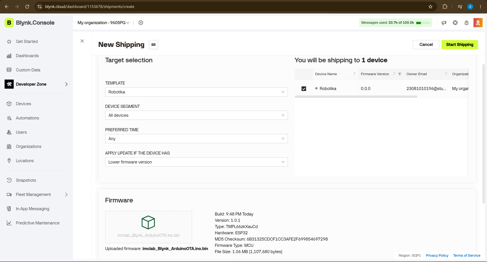
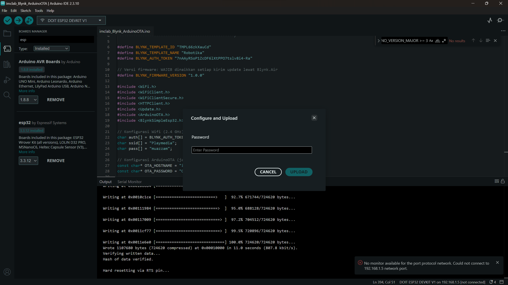

# LAPORAN PRAKTIKUM ROBOTIKA

## Modul 4: Implementasi Over-The-Air (OTA) pada ESP32 Menggunakan Blynk.Air dan ArduinoOTA

# BAB 1
## PENDAHULUAN

### 1.1 Latar Belakang

ESP32 merupakan mikrokontroler yang memiliki kemampuan komunikasi Wi-Fi sehingga dapat digunakan untuk mengembangkan sistem Internet of Things (IoT). Dalam pengembangan perangkat berbasis mikrokontroler, program perlu diperbarui ketika terdapat perubahan fungsi, perbaikan kesalahan, atau penambahan fitur. Proses pembaruan yang selalu menggunakan kabel USB dapat menjadi kurang praktis, terutama ketika perangkat sudah terpasang pada sistem.

Salah satu solusi untuk mengatasi hal tersebut adalah **Over-The-Air (OTA)**, yaitu metode pembaruan firmware melalui jaringan tanpa harus mengunggah program menggunakan kabel USB setiap kali dilakukan perubahan. Pada praktikum Modul 4, ESP32 menerapkan dua metode OTA, yaitu Blynk.Air untuk pembaruan melalui layanan Blynk IoT dan ArduinoOTA untuk pembaruan melalui jaringan Wi-Fi lokal.

Melalui praktikum ini, mahasiswa mempelajari konfigurasi OTA, proses pengiriman firmware, pemantauan status pembaruan, serta penanganan kesalahan. Sistem juga dirancang agar motor dihentikan selama proses pembaruan untuk mengurangi risiko gerakan yang tidak diinginkan.

### 1.2 Spesifikasi Perangkat dan Sistem

| Komponen/Parameter | Spesifikasi |
|---|---|
| Mikrokontroler | ESP32 |
| Platform pemrograman | Arduino IDE |
| Metode OTA | Blynk.Air dan ArduinoOTA |
| Koneksi jaringan | Wi-Fi 2,4 GHz |
| Hostname ArduinoOTA | `iMCLab-ESP32` |
| Pustaka OTA lokal | `ArduinoOTA.h` |
| Pustaka pembaruan firmware | `Update.h` |
| Pustaka komunikasi HTTP | `HTTPClient.h` |
| Pustaka koneksi aman | `WiFiClientSecure.h` |
| Kecepatan Serial Monitor | 115200 baud |

# BAB 2
## DASAR TEORI

**Over-The-Air (OTA)** adalah mekanisme pembaruan firmware perangkat melalui jaringan komunikasi. Dengan OTA, firmware dapat dikirim ke ESP32 tanpa perlu melakukan proses unggah melalui kabel USB pada setiap pembaruan. Metode ini membantu proses pemeliharaan perangkat dan mempermudah pengembangan sistem yang sudah dipasang di lokasi tertentu.

**Blynk.Air** merupakan metode pembaruan firmware melalui layanan Blynk. Pada kode praktikum, permintaan pembaruan diterima melalui `BLYNK_WRITE(InternalPinOTA)`, kemudian URL firmware digunakan untuk mengunduh berkas menggunakan HTTP atau HTTPS. Pustaka `Update.h` menangani penulisan firmware ke partisi pembaruan. Program memeriksa status respons HTTP, ukuran firmware, jumlah data yang berhasil ditulis, dan status akhir pembaruan sebelum melakukan restart ESP32.

**ArduinoOTA** digunakan untuk memperbarui firmware melalui jaringan Wi-Fi lokal. Program mengatur hostname dan kata sandi menggunakan `ArduinoOTA.setHostname()` serta `ArduinoOTA.setPassword()`. Fungsi `ArduinoOTA.handle()` harus dipanggil secara rutin di dalam `loop()` agar proses OTA dapat berjalan. Kedua metode memiliki jalur pembaruan yang berbeda, tetapi sama-sama memerlukan koneksi jaringan yang sesuai dan penanganan kondisi kegagalan.

# BAB 3
## PELAKSANAAN PRAKTIKUM

### 3.1 Tujuan Praktikum

1. Memahami konsep dan fungsi Over-The-Air pada ESP32.
2. Menerapkan pembaruan firmware melalui Blynk.Air.
3. Menerapkan pembaruan firmware melalui ArduinoOTA pada jaringan Wi-Fi lokal.
4. Memahami konfigurasi hostname, autentikasi, dan versi firmware.
5. Mengamati status proses pembaruan dan menangani kesalahan OTA.

### 3.2 Alat dan Bahan

1. ESP32.
2. Komputer atau laptop.
3. Arduino IDE.
4. Jaringan Wi-Fi 2,4 GHz.
5. Akun dan perangkat pada Blynk IoT.
6. Kabel USB untuk pemrograman awal.
7. Pustaka Arduino yang dibutuhkan oleh program OTA.

### 3.3 Program

Program Modul 4 berfokus pada dua implementasi OTA, yaitu Blynk.Air dan ArduinoOTA. Kode lengkap ditulis pada bagian ini oleh praktikan. Bagian inti yang perlu diperhatikan adalah:

- Konfigurasi versi firmware melalui `BLYNK_FIRMWARE_VERSION`.
- Penerimaan permintaan OTA dari Blynk.Air.
- Pengunduhan firmware melalui URL.
- Pemeriksaan ukuran, penulisan, dan validasi hasil pembaruan.
- Konfigurasi hostname dan kata sandi ArduinoOTA.
- Penanganan status mulai, progres, selesai, dan kesalahan.
- Pemanggilan `ArduinoOTA.handle()` di dalam `loop()`.
- Penghentian motor sebelum proses OTA dilakukan.


```cpp

#define BLYNK_TEMPLATE_ID "********"
#define BLYNK_TEMPLATE_NAME "Robotika"
#define BLYNK_AUTH_TOKEN "********"

// Versi firmware: WAJIB dinaikkan setiap kirim update lewat Blynk.Air
#define BLYNK_FIRMWARE_VERSION "1.0.1"

#include <WiFi.h>
#include <WiFiClient.h>
#include <WiFiClientSecure.h>
#include <HTTPClient.h>
#include <Update.h>
#include <ArduinoOTA.h>          
#include <BlynkSimpleEsp32.h>

// Konfigurasi Wifi (2.4 GHz)
char auth[] = BLYNK_AUTH_TOKEN;
char ssid[] = "*****";
char pass[] = "*****";

// Konfigurasi ArduinoOTA (jaringan lokal)      
const char* OTA_HOSTNAME = "iMCLab-ESP32";       
const char* OTA_PASSWORD = "********";           

// ============================================================
// Motor dan LED
// ============================================================
int ledPin = 2;

int motor1Pin1 = 27;
int motor1Pin2 = 26;
int enable1Pin = 12;

// ============================================================
// Sensor RPM
// ============================================================
const byte pin_rpm = 13;
const int HOLES = 2;

volatile unsigned int rev = 0;
volatile unsigned long lastPulseTime = 0;
const unsigned long DEBOUNCE_US = 500;

// ============================================================
// PWM
// ============================================================
const int freq = 30000;
const int pwmChannel = 0;
const int resolution = 8;
int dutyCycle = 200;
const int DUTY_STEP = 10;
const int DUTY_MIN = 0;
const int DUTY_MAX = 255;
bool motorEnable = false;

// ============================================================
// RPM
// ============================================================
float rpm = 0.0;
unsigned long old_time = 0;

// ============================================================
String inputString = "";
BlynkTimer timer;

// ============================================================
// OTA (Blynk.Air)
// ============================================================
String otaUrl;
bool otaRequested = false;

// ============================================================
// PWM helper (kompatibel core ESP32 2.x dan 3.x)
// ============================================================
void pwmBegin()
{
#if defined(ESP_ARDUINO_VERSION_MAJOR) && ESP_ARDUINO_VERSION_MAJOR >= 3
  ledcAttach(enable1Pin, freq, resolution);
#else
  ledcSetup(pwmChannel, freq, resolution);
  ledcAttachPin(enable1Pin, pwmChannel);
#endif
}

void pwmWrite(int duty)
{
#if defined(ESP_ARDUINO_VERSION_MAJOR) && ESP_ARDUINO_VERSION_MAJOR >= 3
  ledcWrite(enable1Pin, duty);
#else
  ledcWrite(pwmChannel, duty);
#endif
}

// ============================================================
// ISR Encoder
// ============================================================
void IRAM_ATTR isr()
{
  unsigned long now = micros();
  if (now - lastPulseTime > DEBOUNCE_US)
  {
    rev++;
    lastPulseTime = now;
  }
}

// ============================================================
// Sync setelah reconnect Blynk
// ============================================================
BLYNK_CONNECTED()
{
  Blynk.syncVirtual(V2);
  Blynk.syncVirtual(V3);
}

// ============================================================
// Hitung RPM
// ============================================================
void hitungRPM()
{
  unsigned long cur_time = millis();

  if (cur_time - old_time >= 1000)
  {
    detachInterrupt(digitalPinToInterrupt(pin_rpm));

    float rot_per_sec = (float)rev / (float)HOLES;
    rpm = rot_per_sec * 60.0;
    rev = 0;

    attachInterrupt(digitalPinToInterrupt(pin_rpm), isr, FALLING);
    old_time = millis();
  }
}

// ============================================================
// Terapkan PWM ke Motor
// ============================================================
void applyMotor()
{
  digitalWrite(motor1Pin1, HIGH);
  digitalWrite(motor1Pin2, LOW);
  pwmWrite(dutyCycle);
  digitalWrite(ledPin, dutyCycle > 0);
}

// Hentikan motor total (dipakai sebelum OTA)
void stopMotor()
{
  dutyCycle = 0;
  motorEnable = false;
  digitalWrite(motor1Pin1, LOW);
  digitalWrite(motor1Pin2, LOW);
  pwmWrite(0);
  digitalWrite(ledPin, LOW);
}

// ============================================================
// Status Serial
// ============================================================
void tampilkanStatus(const char* aksi)
{
  Serial.print(aksi);
  Serial.print(" | PWM=");
  Serial.print(dutyCycle);
  Serial.print(" | RPM=");
  Serial.println(rpm, 1);
}

// ============================================================
// Kirim Data ke Blynk
// ============================================================
void kirimKeBlynk()
{
  Blynk.virtualWrite(V0, rpm);
  Blynk.virtualWrite(V1, dutyCycle);
  Blynk.virtualWrite(V2, dutyCycle);
  Blynk.virtualWrite(V3, dutyCycle > 0);
}

// ============================================================
// Slider PWM dari Blynk (V2)
// ============================================================
BLYNK_WRITE(V2)
{
  dutyCycle = constrain(param.asInt(), DUTY_MIN, DUTY_MAX);
  motorEnable = (dutyCycle > 0);
  applyMotor();
  Serial.print("PWM dari Blynk = ");
  Serial.println(dutyCycle);
}

// ============================================================
// Tombol ON/OFF dari Blynk (V3)
// ============================================================
BLYNK_WRITE(V3)
{
  motorEnable = param.asInt();

  if (motorEnable)
  {
    if (dutyCycle == 0)
      dutyCycle = 200;
  }
  else
  {
    dutyCycle = 0;
  }

  applyMotor();
  Serial.print("Motor ");
  Serial.println(motorEnable ? "ON" : "OFF");
}

// ============================================================
// OTA 1: Blynk.Air
// ============================================================
BLYNK_WRITE(InternalPinOTA)
{
  otaUrl = param.asString();
  otaRequested = true;
  Serial.println("[Blynk.Air] Permintaan OTA diterima");
}

void runBlynkAirOTA()
{
  stopMotor();
  detachInterrupt(digitalPinToInterrupt(pin_rpm));
  Serial.println("[Blynk.Air] URL: " + otaUrl);

  Blynk.disconnect();

  HTTPClient http;
  WiFiClient plainClient;
  WiFiClientSecure secureClient;

  if (otaUrl.startsWith("https"))
  {
    secureClient.setInsecure();
    http.begin(secureClient, otaUrl);
  }
  else
  {
    http.begin(plainClient, otaUrl);
  }

  const char* headerKeys[] = { "x-MD5" };
  http.collectHeaders(headerKeys, 1);

  int httpCode = http.GET();
  if (httpCode != HTTP_CODE_OK)
  {
    Serial.printf("[Blynk.Air] Gagal, HTTP code = %d\n", httpCode);
    http.end();
    attachInterrupt(digitalPinToInterrupt(pin_rpm), isr, FALLING);
    return;
  }

  int contentLength = http.getSize();
  Serial.printf("[Blynk.Air] Ukuran firmware: %d byte\n", contentLength);

  if (contentLength <= 0 || !Update.begin(contentLength))
  {
    Serial.println("[Blynk.Air] Partisi OTA tidak cukup / ukuran tidak valid");
    http.end();
    attachInterrupt(digitalPinToInterrupt(pin_rpm), isr, FALLING);
    return;
  }

  if (http.hasHeader("x-MD5"))
  {
    String md5 = http.header("x-MD5");
    if (md5.length() == 32)
    {
      md5.toLowerCase();
      Update.setMD5(md5.c_str());
      Serial.println("[Blynk.Air] MD5: " + md5);
    }
  }

  unsigned long t0 = millis();
  size_t written = Update.writeStream(http.getStream());
  http.end();

  Serial.printf("[Blynk.Air] Tertulis %u / %d byte dalam %lu ms\n",
                (unsigned)written, contentLength, millis() - t0);

  if (written != (size_t)contentLength || !Update.end() || !Update.isFinished())
  {
    Serial.printf("[Blynk.Air] Update gagal, error #%d\n", Update.getError());
    attachInterrupt(digitalPinToInterrupt(pin_rpm), isr, FALLING);
    return;
  }

  Serial.println("[Blynk.Air] Update sukses, reboot...");
  delay(500);
  ESP.restart();
}

// ============================================================
// OTA 2: ArduinoOTA (WiFi lokal)                 
// ============================================================
void setupArduinoOTA()
{
  ArduinoOTA.setHostname(OTA_HOSTNAME);
  ArduinoOTA.setPassword(OTA_PASSWORD);

  ArduinoOTA.onStart([]() {
    stopMotor();                                  // motor mati selama update
    detachInterrupt(digitalPinToInterrupt(pin_rpm));
    Serial.println("[ArduinoOTA] Mulai update");
  });

  ArduinoOTA.onProgress([](unsigned int progress, unsigned int total) {
    Serial.printf("[ArduinoOTA] Progres: %u%%\r", (progress * 100) / total);
  });

  ArduinoOTA.onEnd([]() {
    Serial.println("\n[ArduinoOTA] Selesai, reboot...");
  });

  ArduinoOTA.onError([](ota_error_t error) {
    Serial.printf("[ArduinoOTA] Error[%u]\n", error);
    attachInterrupt(digitalPinToInterrupt(pin_rpm), isr, FALLING);
  });

  ArduinoOTA.begin();

  Serial.print("[ArduinoOTA] Siap | Hostname: ");
  Serial.print(OTA_HOSTNAME);
  Serial.print(" | IP: ");
  Serial.println(WiFi.localIP());
}

// ============================================================
// Setup
// ============================================================
void setup()
{
  Serial.begin(115200);

  pinMode(ledPin, OUTPUT);
  pinMode(motor1Pin1, OUTPUT);
  pinMode(motor1Pin2, OUTPUT);
  pinMode(enable1Pin, OUTPUT);
  pinMode(pin_rpm, INPUT_PULLUP);

  attachInterrupt(digitalPinToInterrupt(pin_rpm), isr, FALLING);

  pwmBegin();

  digitalWrite(motor1Pin1, HIGH);
  digitalWrite(motor1Pin2, LOW);
  pwmWrite(0);

  old_time = millis();

  // Koneksi ke Blynk (sekaligus WiFi)
  Blynk.begin(auth, ssid, pass);

  setupArduinoOTA();                              

  timer.setInterval(1000L, kirimKeBlynk);

  Serial.println("================================");
  Serial.println("iMCLab + Blynk + OTA Ready");
  Serial.println("Firmware v" BLYNK_FIRMWARE_VERSION);
  Serial.println("================================");
  Serial.println("1 = ON");
  Serial.println("0 = OFF");
  Serial.println("+ = PWM naik");
  Serial.println("- = PWM turun");
  Serial.println("PWM:200");
  Serial.println("R = lihat RPM");
  Serial.println("V = lihat versi firmware");
}

// ============================================================
// Loop
// ============================================================
void loop()
{
  if (otaRequested)
  {
    otaRequested = false;
    runBlynkAirOTA();
  }

  ArduinoOTA.handle();                            
  Blynk.run();
  timer.run();
  hitungRPM();

  while (Serial.available() > 0)
  {
    char c = Serial.read();

    if (c == '\n')
    {
      inputString.trim();

      if (inputString.startsWith("PWM:"))
      {
        int val = inputString.substring(4).toInt();
        val = constrain(val, DUTY_MIN, DUTY_MAX);

        dutyCycle = val;
        motorEnable = (dutyCycle > 0);
        applyMotor();
        tampilkanStatus("Set PWM");
      }
      else if (inputString.length() > 0)
      {
        char cmd = inputString.charAt(0);

        if (cmd == '1')
        {
          if (dutyCycle == 0)
            dutyCycle = 200;

          motorEnable = true;
          applyMotor();
          tampilkanStatus("Motor ON");
        }
        else if (cmd == '0')
        {
          dutyCycle = 0;
          motorEnable = false;
          applyMotor();
          Serial.println("Motor OFF");
        }
        else if (cmd == '+')
        {
          dutyCycle += DUTY_STEP;
          if (dutyCycle > DUTY_MAX)
            dutyCycle = DUTY_MAX;

          motorEnable = true;
          applyMotor();
          tampilkanStatus("PWM NAIK");
        }
        else if (cmd == '-')
        {
          dutyCycle -= DUTY_STEP;
          if (dutyCycle < DUTY_MIN)
            dutyCycle = DUTY_MIN;

          motorEnable = (dutyCycle > 0);
          applyMotor();
          tampilkanStatus("PWM TURUN");
        }
        else if (cmd == 'R' || cmd == 'r')
        {
          Serial.print("RPM = ");
          Serial.print(rpm, 1);
          Serial.print(" | PWM = ");
          Serial.println(dutyCycle);
        }
        else if (cmd == 'V' || cmd == 'v')
        {
          Serial.println("Firmware v" BLYNK_FIRMWARE_VERSION);
        }
      }
      inputString = "";
    }
    else if (c != '\r')
    {
      inputString += c;
    }
  }
}
```

### 3.4 Prosedur Pengujian

#### A. Pengujian Blynk.Air

1. Hubungkan ESP32 ke jaringan Wi-Fi dan pastikan perangkat terhubung ke Blynk.
2. Siapkan firmware yang akan diperbarui melalui Blynk.Air.
3. Pastikan versi firmware pada kode sesuai dengan versi yang akan dikirim.
4. Jalankan proses pembaruan dari layanan Blynk.Air sesuai konfigurasi perangkat.
5. Amati Serial Monitor untuk melihat apakah permintaan OTA diterima.
6. Periksa pesan pengunduhan, ukuran firmware, proses penulisan, dan status akhir.

#### B. Pengujian ArduinoOTA

1. Unggah program awal ke ESP32 menggunakan USB.
2. Pastikan komputer dan ESP32 berada pada jaringan Wi-Fi lokal yang sama.
3. Periksa Serial Monitor untuk mengetahui hostname dan alamat IP ESP32.
4. Buka menu port pada Arduino IDE dan pilih perangkat jaringan ESP32 yang terdeteksi.
5. Lakukan unggah program melalui jaringan.
6. Amati status proses OTA pada Serial Monitor.

### 3.5 Hasil Pengujian

Tabel berikut digunakan untuk mencatat hasil pengujian aktual.

| No. | Pengujian | Hasil yang Diharapkan | Hasil Aktual |
|---|---|---|---|
| 1 | Koneksi ESP32 ke Wi-Fi | ESP32 terhubung ke jaringan | Berhasil |
| 2 | Permintaan OTA melalui Blynk.Air | Permintaan pembaruan diterima | Berhasil |
| 3 | Pengunduhan firmware Blynk.Air | Berkas firmware dapat diunduh | Berhasil |
| 4 | Penulisan firmware | Data firmware ditulis ke partisi pembaruan | Berhasil |
| 5 | Pembaruan ArduinoOTA | ESP32 dapat menerima firmware melalui jaringan lokal | Berhasil |
| 6 | Penanganan kegagalan OTA | Pesan kesalahan ditampilkan dan penanganan kegagalan dijalankan | Berhasil |

### 3.6 Analisis

Implementasi dua metode OTA memberikan pilihan dalam proses pembaruan firmware ESP32. Blynk.Air menggunakan permintaan dari layanan Blynk dan URL firmware untuk menjalankan proses pengunduhan serta penulisan firmware. ArduinoOTA menggunakan jaringan Wi-Fi lokal dan menyediakan konfigurasi hostname, autentikasi, serta callback untuk memantau jalannya pembaruan.

Pada kode yang digunakan, proses OTA dirancang untuk menghentikan motor dan menonaktifkan interrupt sensor sebelum pembaruan dilakukan. Langkah ini bertujuan mengurangi risiko aktuator bergerak selama proses pembaruan. Program juga memeriksa beberapa kondisi, seperti respons HTTP, ukuran firmware, jumlah data yang ditulis, dan status akhir pembaruan Blynk.Air.

Meskipun demikian, rancangan kode belum membuktikan keberhasilan OTA sampai pengujian aktual dilakukan. Hasil perlu diperiksa melalui pesan Serial Monitor, keberhasilan perangkat melakukan restart, dan kemampuan ESP32 menjalankan firmware setelah pembaruan.

# BAB 4
## DOKUMENTASI

### 4.1 OTA pada Blynk.Air



### 4.2 OTA pada ArduinoOTA



# BAB 5
## KESIMPULAN

Praktikum Modul 4 membahas penerapan Over-The-Air (OTA) pada ESP32 dengan dua metode, yaitu Blynk.Air dan ArduinoOTA. Blynk.Air digunakan untuk menerima permintaan pembaruan melalui layanan Blynk dan mengunduh firmware dari URL, sedangkan ArduinoOTA digunakan untuk mengunggah firmware melalui jaringan Wi-Fi lokal.

Kedua metode tersebut memerlukan konfigurasi jaringan yang tepat serta penanganan proses pembaruan, termasuk pemeriksaan kesalahan dan restart perangkat setelah pembaruan berhasil. Program juga dirancang untuk menghentikan motor sebelum proses OTA agar risiko gerakan aktuator selama pembaruan dapat dikurangi.

Dengan praktikum ini, mahasiswa dapat mempelajari dasar pembaruan firmware secara nirkabel dan memahami perbedaan alur kerja Blynk.Air dengan ArduinoOTA. Keberhasilan implementasi harus disimpulkan berdasarkan hasil pengujian aktual dan dokumentasi proses pembaruan yang dilakukan.